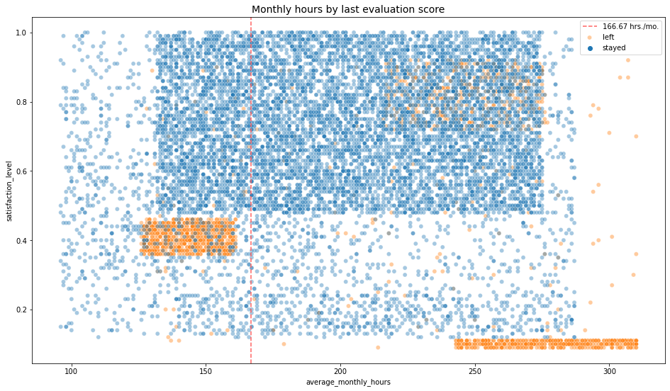
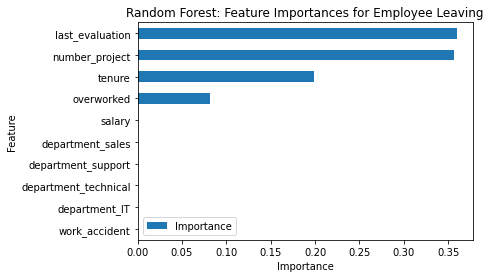

# Employee Attrition & Retention Predictive Modeling (Salifort Motors Capstone)

**Identifying 90.4% of At-Risk Employees via Leak-Resistant Random Forest & PACE Exploratory Data Analysis (N = 14,999)**

- **Author:** Juan Pablo Larios (*Google Advanced Data Analytics Certified — [Verify Credly Badge](https://www.credly.com/badges/625bc826-6541-4c9b-b496-e057e9f2f25e/public_url)*)
- **Methodology:** PACE Workflow (`Plan → Analyze → Construct → Execute`)
- **Stack:** Python (`pandas`, `numpy`, `seaborn`, `matplotlib`, `scikit-learn`), Jupyter Notebook

---

## Executive Summary

### 1. Business Problem
High employee turnover (`16.6%` across `11,991` unique employee records) was costing Salifort Motors significant recruiting and onboarding overhead. Leadership needed to uncover the root operational drivers of attrition and deploy a reliable early-warning model to flag at-risk staff *before* resignation.

### 2. PACE Methodology & Analytical Findings
| PACE Phase | Execution & Key Findings |
| :--- | :--- |
| **Plan** | Scoped HR retention objectives, evaluated data ethics/survey leakage risks, and established **ROC-AUC** and **Recall** as primary decision metrics. |
| **Analyze** | Removed `3,008` duplicate rows (`14,999 → 11,991` unique employees). Discovered a critical burnout threshold: employees working **`>175–240+` hours/month** or assigned **`6–7` concurrent projects** experienced near-100% attrition despite high performance evaluations. |
| **Construct** | Benchmarked a **Logistic Regression** baseline (`83.0%` recall) against **Decision Tree** and **Random Forest** ensembles (`GridSearchCV`, 4-fold CV). Constructed a **Round-2 Leak-Resistant Model** replacing self-reported `satisfaction_level` with an objective `overworked` workload feature (`>175 hrs/mo`). |
| **Execute** | Delivered feature-importance rankings, confusion matrices, and a 4-point HR policy roadmap to cap workload and restructure promotion/compensation reviews at the 3–5 year tenure mark. |

### 3. Model Performance Benchmark (Test Set)

| Model | Precision | Recall | F1-Score | Accuracy | ROC-AUC | Deployment Notes |
| :--- | :---: | :---: | :---: | :---: | :---: | :--- |
| **Logistic Regression (Baseline)** | 80.0% | 83.0% | 80.0% | 83.0% | — | Interpretable odds-ratio baseline |
| **Random Forest — Round 1 (All Features)** | **96.4%** | **92.0%** | **94.1%** | **98.1%** | **0.956** | High accuracy, relies on survey `satisfaction_level` |
| **Random Forest — Round 2 (Leak-Resistant)** | **87.0%** | **90.4%** | **88.7%** | **96.2%** | **0.938** | **Production Champion** (uses objective HR ops data only) |

### 4. Top Business Recommendations
1. **Cap Project Load at 5 Concurrent Projects:** Employees assigned `6+` projects showed the sharpest spike in voluntary and involuntary exits (`100%` churn at `7` projects).
2. **Workload Alerts at >175 Hours/Month:** Replace reactive exit surveys with automated HR workload alerts triggered by the `overworked` indicator (`average_monthly_hours > 175`).
3. **4-Year Tenure Promotion & Compensation Review:** Tenure shows a sharp attrition cliff at years `3–5` where high performers have received `<2%` promotions over 5 years.

---

## Repository Structure
- `notebooks/01_salifort_employee_retention_pace.ipynb` — Complete executed PACE Jupyter Notebook
- `reports/figures/` — 16 exported diagnostic, EDA, confusion-matrix, and feature-importance charts
- `data/raw/` — Raw dataset storage (gitignored by default for data governance)
